---

## 👑 Sobre mim

Sou estudante e desenvolvedor de software, movido pela paixão por **tecnologia**, **inovação** e pela criação de soluções que geram valor. Tenho experiência na criação de aplicações **web** e **mobile**, usando diferentes linguagens, frameworks e ferramentas para desenvolver sistemas modernos, escaláveis e de alta qualidade.

> 💎 *Acredito na evolução contínua e estou sempre explorando novas tecnologias para resolver desafios cada vez mais complexos.*

---

## ⚡ Tecnologias

  

---

## 🚀 Áreas de Atuação

| 🌐 Desenvolvimento Web | 📱 Desenvolvimento Mobile | 👑 Full Stack |
|:---:|:---:|:---:|
| Interfaces modernas e responsivas | Aplicativos Android | Do front ao back-end |
| React • TypeScript • JavaScript | Kotlin • Java • React Native | Soluções completas e escaláveis |

---

## 🎯 Objetivo

Projetar e desenvolver aplicações **modernas**, **eficientes** e **escaláveis**, seguindo boas práticas de engenharia de software, arquitetura limpa e código de qualidade, sempre buscando criar soluções inovadoras com uma excelente experiência para o usuário.

---

## 📈 Em constante evolução

A tecnologia está em constante transformação, e o aprendizado contínuo é essencial para acompanhar essa evolução. Estou sempre estudando novas linguagens, frameworks e metodologias, aperfeiçoando minhas competências e enfrentando desafios cada vez mais relevantes.

